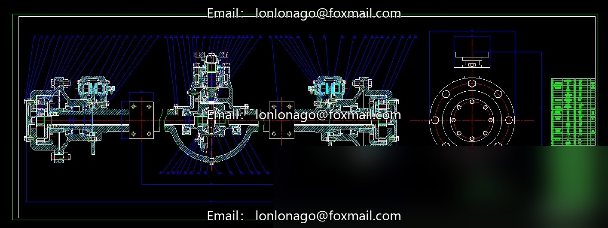
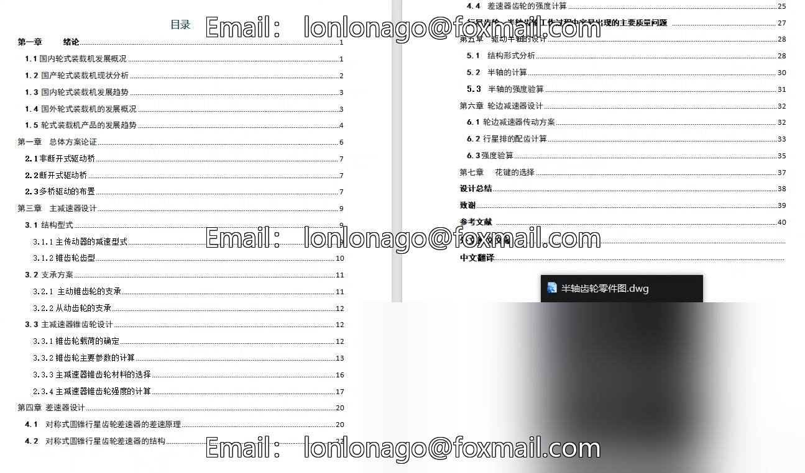
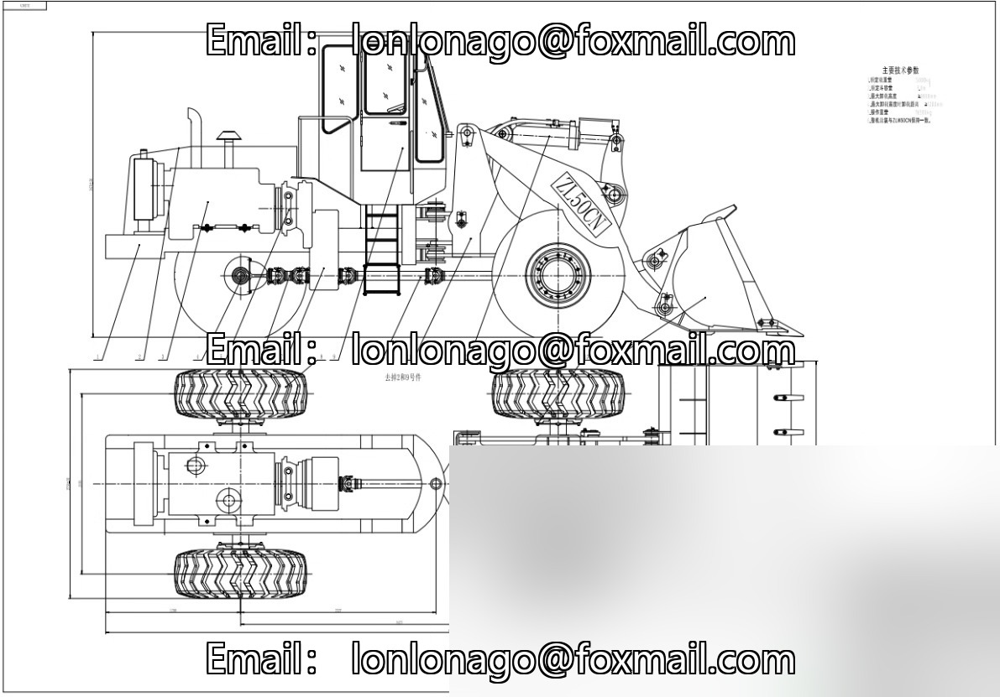
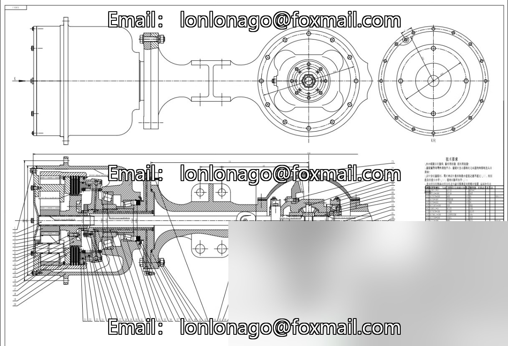

# Rider engine drive bridge design, Rider engine drive bridge structure design, Rider engine drive bridge design drawing

## Body

loader driving bridge design; loader driving bridge structural design; loader driving bridge design diagram; loader driving bridge design CAD diagram; loader driving bridge structural design diagram.
This material contains two sets of loader driving bridge design materials, all including CAD diagrams and instructions; the illustrations clearly mark 1 and 2. If needed, similar three-dimensional drawings of the driving bridge can be provided separately. 536

The material covers design, structural design and design diagrams of the loader drive bridge, including CAD diagrams, instructions, and additional three-dimensional drawings of comparable drive bridges.

<!-- AI_ENRICHED -->

## Images

## Payment

Here is a pay link on Stripe ( https://buy.stripe.com/3cs8yP7sY87d0vu9AB ). Please contact me lonlonago@foxmail.com after funding $89, and I will send you a complete data files , thank you!

